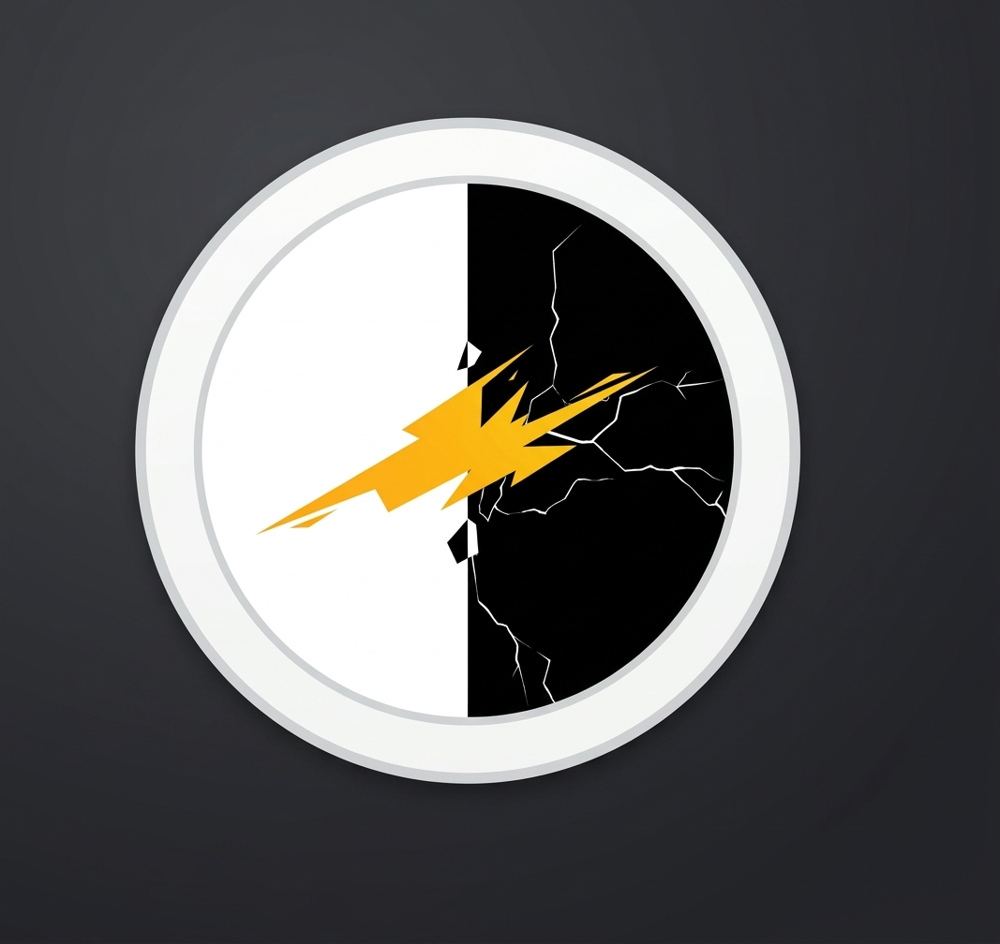

<!-- Header Section with Minimalist Gradient -->

  
   
  

 

<!-- About Section (Styled like a clean card) -->
<h2 style="font-family: 'Segoe UI', sans-serif; font-weight: 600; border-bottom: 1px solid #30363d; padding-bottom: 5px;">About</h2>

  I build practical, robust security tools: automated wireless penetration frameworks and secure web applications. My focus is on clean interfaces and building open-source projects that people can use without friction. 

<ul style="font-family: 'Segoe UI', sans-serif; font-size: 15px; color: #c9d1d9; line-height: 1.6;">
  <li>⚡ Developing <b>X-MAP-Auto-Phantom</b> for wireless security testing (2.4GHz & 5GHz)</li>
  <li>🛡️ Working across Python, Shell Scripting, PHP, and C</li>
  <li>💻 Exploring Linux internals and low-level system security</li>
</ul>

 

<!-- Technologies (Clean Icons) -->
<h2 style="font-family: 'Segoe UI', sans-serif; font-weight: 600; border-bottom: 1px solid #30363d; padding-bottom: 5px;">Technologies</h2>

  

 

<!-- Featured Projects (Aesthetic Table matching your theme) -->
<h2 style="font-family: 'Segoe UI', sans-serif; font-weight: 600; border-bottom: 1px solid #30363d; padding-bottom: 5px;">Featured Projects</h2>

<table style="width: 100%; border-collapse: collapse; font-family: 'Segoe UI', sans-serif; font-size: 14px; color: #c9d1d9;">
  <thead>
    <tr style="border-bottom: 2px solid #30363d; text-align: left;">
      <th style="padding: 10px 5px; color: #FFD700;">Project</th>
      <th style="padding: 10px 5px; color: #FFD700;">Description</th>
      <th style="padding: 10px 5px; color: #FFD700;">Stack</th>
    </tr>
  </thead>
  <tbody>
    <tr style="border-bottom: 1px solid #21262d;">
      <td style="padding: 10px 5px;"><a href="https://github.com/X-map-arch/X-MAP-Auto-Phantom" style="color: #58a6ff; text-decoration: none; font-weight: bold;">X-MAP-Auto-Phantom</a></td>
      <td style="padding: 10px 5px;">An automated, cinematic Evil Twin attack framework for wireless penetration testing with Captive Portal.</td>
      <td style="padding: 10px 5px;"></td>
    </tr>
    <tr style="border-bottom: 1px solid #21262d;">
      <td style="padding: 10px 5px;"><a href="https://github.com/X-map-arch/PORTFOLIO" style="color: #58a6ff; text-decoration: none; font-weight: bold;">PORTFOLIO</a></td>
      <td style="padding: 10px 5px;">Personal aesthetic portfolio website showcasing projects and skills.</td>
      <td style="padding: 10px 5px;"></td>
    </tr>
    <tr style="border-bottom: 1px solid #21262d;">
      <td style="padding: 10px 5px;"><a href="https://github.com/X-map-arch/MEDILINK" style="color: #58a6ff; text-decoration: none; font-weight: bold;">MEDILINK</a></td>
      <td style="padding: 10px 5px;">A secure web-based platform connecting patients and medical services.</td>
      <td style="padding: 10px 5px;"></td>
    </tr>
  </tbody>
</table>

 

<!-- GitHub Activity (Matching the screenshot style) -->
<h2 style="font-family: 'Segoe UI', sans-serif; font-weight: 600; border-bottom: 1px solid #30363d; padding-bottom: 5px;">GitHub Activity</h2>

  
  &nbsp;
  
  &nbsp;
  

 

<!-- Connect Section -->
<h2 style="font-family: 'Segoe UI', sans-serif; font-weight: 600; border-bottom: 1px solid #30363d; padding-bottom: 5px;">Connect</h2>

  
  

 

<!-- Footer Gradient -->

  
  

    <i>"Securing the wireless waves, one packet at a time."</i>
  

